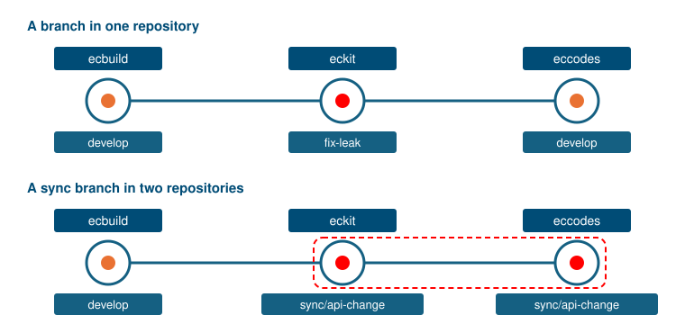

.. SPDX-FileCopyrightText: 2026 European Centre for Medium-Range Weather Forecasts (ECMWF)
..
.. SPDX-License-Identifier: Apache-2.0

Coordinated changes across repositories
=======================================

Some changes span several repositories, e.g. a changed ``eckit`` interface that ``eccodes`` starts to use.
Tested one by one, both sides fail:
``eckit``'s :doc:`downstream CI <downstream-ci>` builds ``eccodes``' ``develop``, which does not use the changed interface yet,
and ``eccodes``' own CI builds against ``eckit``'s ``develop``, which does not have it yet.

Such changes go on special branches starting with ``sync/`` or ``feature/``;
the former ``sync-branch/`` still works for branches opened under it.
Whenever a branch with such a prefix exists in two repos, the CI tests these
branches automatically against each other.

         Bottom: eckit and eccodes are both on sync/api-change and are built together; ecbuild is on develop.
   :width: 100%

On such a branch, :action:`resolve-deps` resolves every upstream that has a branch of the same name at that branch,
and all others at their ``ref`` from :doc:`../configuring/manifest`.
In a :doc:`downstream <../configuring/downstream>` run, :action:`pick-ref` likewise checks out each consumer's branch of that name,
where it exists.
In the example, ``eccodes``' ``sync/api-change`` is therefore always built against ``eckit``'s,
while ``ecbuild`` stays on ``develop``.
Any other branch, such as ``fix-leak``, or such a branch that exists in one repository only,
keeps testing against ``ref`` from :doc:`../configuring/manifest`.

If all synchronised pull requests are ready, they shall be merged in rapid succession from upstream to downstream,
``eckit`` before ``eccodes`` in this example.

That order is listed at the end of each pull request's description.
Whenever a pull request from such a branch opens, reopens or closes, :action:`sync-branch-prs` rewrites the list in all of them:
the open and merged pull requests from the branch, upstream first, each once.

.. code:: markdown

   <!-- SYNC-BRANCH_BEGIN -->
   Synchronised rollout:

   - https://github.com/ecmwf/eckit/pull/386
   - https://github.com/ecmwf/eccodes/pull/611
   <!-- SYNC-BRANCH_END -->

The block comes after the Contributor Declaration, where :action:`check-pr-declaration` ignores it;
do not edit it, as the next run replaces it.
It needs at least two pull requests, and in a public repository it lists only those of public repositories,
under the heading ``Synchronised rollout (does not show synced PRs in internal repos):``.
The generator writes the workflow as ``pr-sync-branch.yml`` into every repository with a manifest.

This does not work for pull requests from forks: a fork's branch name is never matched,
and its pull request is always built against the ``ref`` of the other repositories, see :doc:`fork-pull-requests`.
A coordinated change therefore needs its branches in the repositories themselves.
